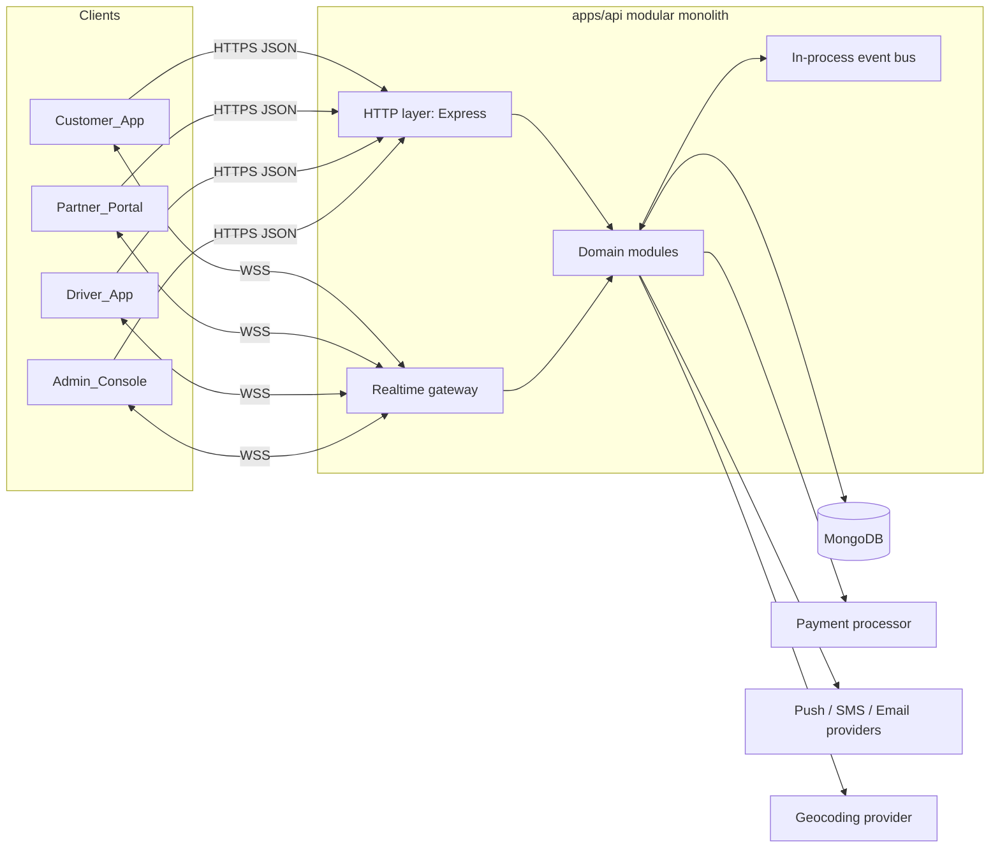
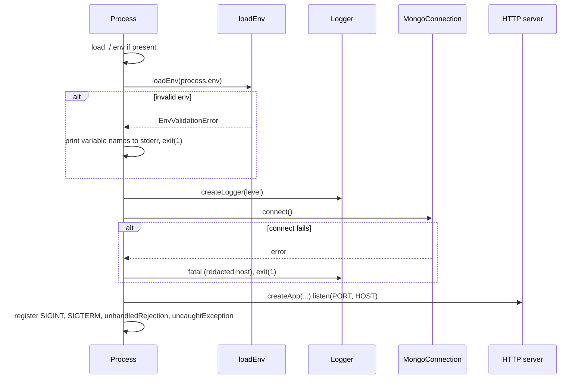
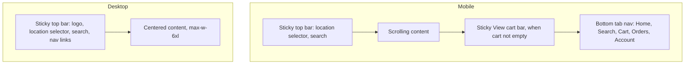
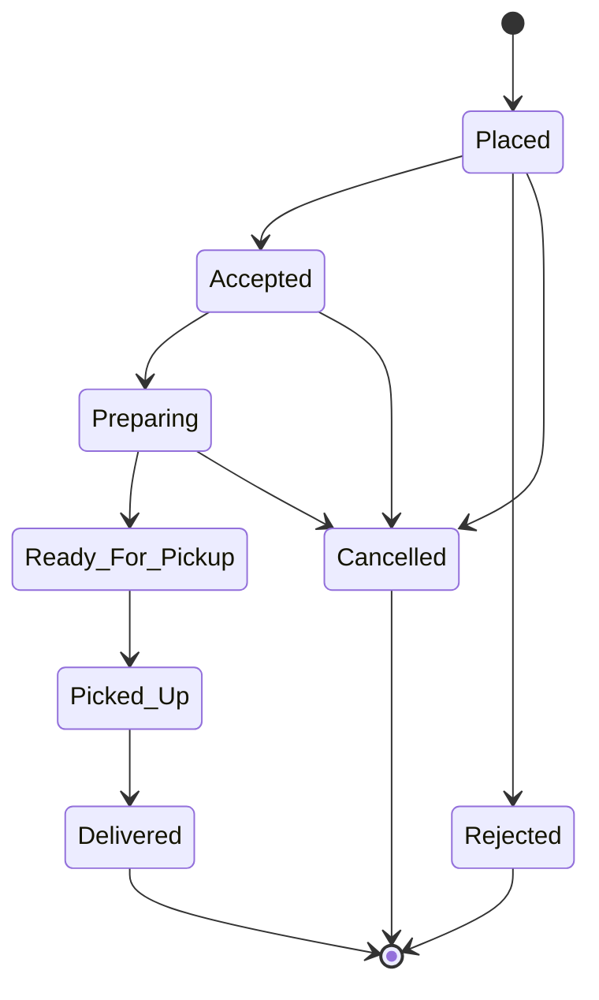

# Design Document: QuickByte Food Delivery

## Overview

QuickByte is built as a TypeScript modular monolith in an npm workspaces monorepo. One backend process (`apps/api`) hosts every domain component from the requirements as an isolated module with an explicit public API. Client applications live beside the backend under `apps/`. The first client is `apps/web` (React + Vite + TypeScript).

Delivery is phased. Phase 1 (Foundation) is designed in concrete detail in this document and is the only phase covered by `tasks.md`. Phases 2 to 8 are described at design level so Phase 1 makes compatible decisions. Each later phase gets its own design refinement and task plan before implementation.

### Approved Stack

| Concern | Choice |
| --- | --- |
| Monorepo | npm workspaces (`apps/api`, `apps/web`) |
| Runtime | Node.js 24 (verified locally: v24.13.0, npm 11.6.2) |
| Backend | TypeScript, Express 5, Mongoose (MongoDB) |
| Validation | Zod (environment and request validation) |
| Logging | Pino + pino-http (structured JSON logs) |
| Frontend | React + Vite + TypeScript |
| Styling | Tailwind CSS v4 (`@tailwindcss/vite`), shadcn/ui conventions (components added via the shadcn CLI from Phase 2 onward), `clsx` + `tailwind-merge`, Inter via `@fontsource-variable/inter` |
| Tests | Vitest, Supertest (API HTTP tests), fast-check (property tests) |
| Lint | ESLint flat config with typescript-eslint |

### Design Principles

1. Modules own their data. No module imports another module's Mongoose models or repositories.
2. Cross-module calls go through a module's `index.ts` public API or through in-process domain events.
3. Factories over singletons. The app, logger, and DB connection are created by functions that take their dependencies, so tests can build isolated instances.
4. Fail fast on bad configuration. The process refuses to start with invalid environment variables.
5. Secrets come only from the environment. `.env` is gitignored; `.env.example` documents keys with placeholder values.
6. Money is integer minor units, timestamps are ISO 8601 UTC (Requirement 23.4).
7. Every dependency is pinned to an exact version (`save-exact=true` in `.npmrc`).

## Architecture

### System Context (Target State)



TLS (Requirement 24.1) terminates at the reverse proxy or load balancer in front of the API. The API sets `trust proxy` once a deployment target is chosen (later phase).

### Component-to-Module Mapping

| Requirement component | Backend module (`apps/api/src/modules/...`) | Phase | Main requirements |
| --- | --- | --- | --- |
| Auth_Service | `auth` (accounts, credentials, sessions, RBAC, approvals state) | 2 | 1, 2, 13.1, 15.1, 21.2-21.4 |
| Customer profile and addresses | `customers` | 2 | 3, 24.3 |
| Catalog_Service | `catalog` (restaurants, hours, zones, menus, modifiers) | 3 | 4, 6, 13 |
| Search_Service | `search` (query, filters, sort over catalog read model) | 3 | 5 |
| Cart_Service | `cart` | 4 | 7, 10.2, 10.7 |
| Checkout_Service | `checkout` (revalidation, pricing, fee config, idempotency) | 4 | 8, 9.1, 9.4-9.6, 21.6 |
| Payment_Gateway | `payments` (adapter over the processor) | 4 | 9, 14.3, 18 |
| Order_Service | `orders` (creation, state machine, history, refunds cap) | 5 | 10, 11, 14, 17.2-17.5, 18 |
| Order_Serializer | `orders/serialization` | 5 | 23 |
| Dispatch_Service | `dispatch` (driver availability, offers, assignment) | 6 | 15, 16, 17.6 |
| Tracking_Service | `tracking` (realtime gateway, location fan-out, ETA) | 6 | 12, 24.4 |
| Review_Service | `reviews` | 7 | 19, 21.5 |
| Notification_Service | `notifications` (provider adapters, preferences) | 7 | 20 |
| Admin_Console backend | `admin` (approval queue, monitoring, disputes, audit log, reports) | 8 | 21, 22 |
| Cross-cutting | `config`, `lib`, `db`, `http` (Phase 1 foundation) | 1 | 24 |

### Module Folder Convention (Phase 2 onward)

Phase 1 creates no module folders. Each later module follows this layout:

```text
apps/api/src/modules/<module>/
  index.ts                  # public API: exported service functions, types, router factory
  <module>.routes.ts        # Express router factory; wires validate() + controller
  <module>.controller.ts    # HTTP adapter: maps req/res to service calls
  <module>.service.ts       # business logic; pure where possible
  <module>.repository.ts    # Mongoose access; only file that touches the model
  <module>.model.ts         # Mongoose schema and model
  <module>.schemas.ts       # Zod request/response schemas
  <module>.events.ts        # domain event type definitions published by this module
  <module>.service.test.ts  # unit and property tests next to the code
```

Rules:
- Other modules import only from `modules/<module>/index.ts`. ESLint `no-restricted-imports` enforces this once modules exist.
- Business rules with universal properties (state machine, pricing, ratings, serialization) live in pure functions so they can be property-tested without a database.
- Routers are mounted under `/api/v1/<module>` by the app factory.

### Phased Delivery

| Phase | Scope | Requirements |
| --- | --- | --- |
| 1. Foundation | Monorepo, tooling, env config, logging, errors, validation, Mongo connection, app factory, health and readiness, graceful shutdown, web shell | 24 (reliability and secret handling foundations) |
| 2. Identity and access | Registration, verification, sign-in, sessions, lockout, password reset, RBAC, customer profile, addresses | 1, 2, 3, 24.3 |
| 3. Catalog and discovery | Restaurant onboarding data, menus, modifiers, hours, zones, browse, search | 4, 5, 6, 13 |
| 4. Cart, checkout, payments | Cart, pricing, revalidation, payment authorization, idempotency | 7, 8, 9 |
| 5. Orders | Order creation, state machine, history, restaurant order management, cancellation, refunds, serializer | 10, 11, 14, 18, 23, 24.6 |
| 6. Dispatch and tracking | Driver onboarding and availability, assignment, delivery updates, realtime tracking | 12, 15, 16, 17, 24.4 |
| 7. Reviews and notifications | Ratings, reviews, push/SMS/email notifications | 19, 20 |
| 8. Administration | Approval queue, suspensions, fee config, audit log, live monitoring, disputes, reports | 21, 22 |

Client applications (Customer_App, Partner_Portal, Driver_App, Admin_Console) are built alongside the backend phase that serves them. Whether they become separate `apps/*` packages or route areas inside `apps/web` is decided in Phase 2's design refinement.

## Components and Interfaces

### Phase 1 Folder Structure

```text
quickbyte/
  .editorconfig
  .gitignore                 # node_modules, dist, coverage, .env, .env.*, !.env.example, *.log
  .npmrc                     # save-exact=true, engine-strict=true
  .nvmrc                     # 24
  eslint.config.js           # flat config for the whole repo
  package.json               # private, workspaces: ["apps/*"], root scripts
  tsconfig.base.json         # shared strict compiler options
  README.md
  apps/
    api/
      .env.example
      package.json
      tsconfig.json          # typecheck: src + tests
      tsconfig.build.json    # emit: src only, excludes *.test.ts
      vitest.config.ts
      src/
        config/
          env.ts             # Zod schema, loadEnv(), EnvValidationError
          env.test.ts
        lib/
          logger.ts          # createLogger(), redaction paths
          logger.test.ts
          app-error.ts       # AppError class and helpers
          shutdown.ts        # createShutdownHandler()
          shutdown.test.ts
        db/
          mongo.ts           # createMongoConnection(), redactMongoUri()
          mongo.test.ts
        http/
          middleware/
            request-logger.ts    # pino-http with request IDs
            validate.ts          # Zod request validation middleware
            validate.test.ts
            not-found.ts
            error-handler.ts
            error-handler.test.ts
          routes/
            health.ts            # GET /health, GET /ready
        app.ts                   # createApp(deps): Express app, no listen
        app.test.ts              # Supertest integration tests
        server.ts                # bootstrap: env, logger, db, listen, signals
    web/
      index.html
      components.json            # shadcn/ui config (no components added in Phase 1)
      package.json
      tsconfig.json              # includes "@/*" path alias
      vite.config.ts             # Tailwind plugin, "@" alias, Vitest config
      src/
        index.css                # Tailwind import + design tokens
        main.tsx
        App.tsx                  # minimal shell, no customer UI
        App.test.tsx             # smoke test
        lib/
          utils.ts               # cn() helper
        vite-env.d.ts
```

### Root Workspace

Root `package.json` (versions resolved at install time and pinned exactly):

```json
{
  "name": "quickbyte",
  "private": true,
  "type": "module",
  "workspaces": ["apps/*"],
  "engines": { "node": ">=24.0.0" },
  "scripts": {
    "dev:api": "npm run dev --workspace @quickbyte/api",
    "dev:web": "npm run dev --workspace @quickbyte/web",
    "lint": "eslint .",
    "typecheck": "npm run typecheck --workspaces --if-present",
    "test": "npm run test --workspaces --if-present",
    "build": "npm run build --workspaces --if-present"
  }
}
```

Root devDependencies are shared tooling only: `typescript`, `eslint`, `@eslint/js`, `typescript-eslint`, `globals`, `eslint-plugin-react-hooks`.

`tsconfig.base.json` enables `strict`, `noUncheckedIndexedAccess`, `exactOptionalPropertyTypes`, `noImplicitOverride`, `isolatedModules`, `verbatimModuleSyntax`, `skipLibCheck`, and `target: ES2023`. Each app sets its own `module`/`moduleResolution` (`NodeNext` for the API, `Bundler` for the web app).

`eslint.config.js` applies `@eslint/js` recommended and `typescript-eslint` recommended type-checked rules to `apps/**/*.{ts,tsx}`, adds `eslint-plugin-react-hooks` for `apps/web`, sets Node globals for `apps/api` and browser globals for `apps/web`, and ignores `**/dist`, `**/coverage`, and `**/node_modules`.

### API Package Scripts

| Script | Command | Purpose |
| --- | --- | --- |
| `dev` | `tsx watch src/server.ts` | Local development with reload |
| `build` | `tsc -p tsconfig.build.json` | Emit `dist/` |
| `start` | `node dist/server.js` | Run the build |
| `typecheck` | `tsc -p tsconfig.json --noEmit` | Type checking incl. tests |
| `test` | `vitest run` | Single test run, no watch |
| `lint` | `eslint .` | Lint the package |

API runtime dependencies: `express`, `mongoose`, `zod`, `pino`, `pino-http`. Dev dependencies: `tsx`, `vitest`, `supertest`, `@types/supertest`, `@types/express`, `@types/node`, `fast-check`. No `dotenv`: Node 24 provides `process.loadEnvFile()`.

### Configuration and Environment Validation (`config/env.ts`)

```typescript
import { z } from 'zod';

const mongoUri = z
  .string()
  .min(1)
  .refine((v) => v.startsWith('mongodb://') || v.startsWith('mongodb+srv://'), {
    message: 'must start with mongodb:// or mongodb+srv://',
  });

export const envSchema = z.object({
  NODE_ENV: z.enum(['development', 'test', 'production']).default('development'),
  HOST: z.string().min(1).default('0.0.0.0'),
  PORT: z.coerce.number().int().min(1).max(65535).default(3000),
  LOG_LEVEL: z.enum(['fatal', 'error', 'warn', 'info', 'debug', 'trace', 'silent']).default('info'),
  MONGODB_URI: mongoUri,
  MONGODB_SERVER_SELECTION_TIMEOUT_MS: z.coerce.number().int().min(100).max(60000).default(5000),
  SHUTDOWN_TIMEOUT_MS: z.coerce.number().int().min(1000).max(120000).default(10000),
});

export type Env = z.infer<typeof envSchema>;

export class EnvValidationError extends Error {
  constructor(public readonly issues: ReadonlyArray<{ variable: string; message: string }>) {
    super(`Invalid environment configuration: ${issues.map((i) => i.variable).join(', ')}`);
    this.name = 'EnvValidationError';
  }
}

/** Pure: reads only the given source. Never includes variable values in errors. */
export function loadEnv(source: Record<string, string | undefined> = process.env): Env {
  const result = envSchema.safeParse(source);
  if (!result.success) {
    throw new EnvValidationError(
      result.error.issues.map((issue) => ({
        variable: String(issue.path[0] ?? '(root)'),
        message: issue.message,
      })),
    );
  }
  return Object.freeze(result.data);
}
```

Decisions:
- `loadEnv` is pure and receives its source, so tests never mutate `process.env`.
- Error messages list variable names and Zod messages only. Zod messages for these validators never echo the input value; the test suite asserts this.
- `.env` loading happens only in `server.ts`: if `./.env` exists, call `process.loadEnvFile('.env')`. Real environment variables set by the deployment platform take precedence because `loadEnvFile` does not overwrite existing keys.
- `apps/api/.env.example` is committed with placeholders, for example `MONGODB_URI=mongodb://localhost:27017/quickbyte`. Credentials never appear in committed files.

### Logger (`lib/logger.ts`)

```typescript
import pino, { type DestinationStream, type Logger, type LevelWithSilent } from 'pino';

export const REDACT_PATHS = [
  'req.headers.authorization',
  'req.headers.cookie',
  'req.headers["x-api-key"]',
  'res.headers["set-cookie"]',
  '*.password',
  '*.passwordHash',
  '*.token',
  '*.accessToken',
  '*.refreshToken',
  '*.secret',
  '*.apiKey',
  '*.mongoUri',
] as const;

export interface LoggerOptions {
  level: LevelWithSilent;
  destination?: DestinationStream; // injected in tests to capture output
}

export function createLogger({ level, destination }: LoggerOptions): Logger {
  return pino(
    {
      level,
      base: { service: 'quickbyte-api' },
      timestamp: pino.stdTimeFunctions.isoTime,
      redact: { paths: [...REDACT_PATHS], censor: '[REDACTED]' },
    },
    destination,
  );
}
```

Logs are JSON on stdout. Developers who want readable output can pipe through `npx pino-pretty`; it is not a project dependency.

### Request Logging and Request IDs (`http/middleware/request-logger.ts`)

- Built on `pino-http` with the injected logger.
- `genReqId`: if the incoming `X-Request-Id` header matches `^[A-Za-z0-9._-]{1,128}$`, reuse it; otherwise generate `crypto.randomUUID()`. Rejecting other values prevents log injection.
- The chosen ID is set on the response as `X-Request-Id` and is available as `req.id` for the error handler.
- Custom log level: `error` for 5xx or thrown errors, `warn` for 4xx, `info` otherwise.
- Serializers log method, URL path, status code, and response time. Headers pass through the redaction paths above.
- `GET /health` and `GET /ready` are logged at `debug` to avoid probe noise.

### Errors (`lib/app-error.ts`)

```typescript
export type ErrorCode =
  | 'VALIDATION_ERROR'
  | 'INVALID_JSON'
  | 'PAYLOAD_TOO_LARGE'
  | 'NOT_FOUND'
  | 'UNAUTHORIZED'
  | 'FORBIDDEN'
  | 'CONFLICT'
  | 'SERVICE_UNAVAILABLE'
  | 'INTERNAL_ERROR';

export interface ErrorDetail {
  location?: 'body' | 'query' | 'params';
  path: string;
  message: string;
}

export class AppError extends Error {
  constructor(
    public readonly statusCode: number,
    public readonly code: ErrorCode,
    message: string,
    public readonly details?: ReadonlyArray<ErrorDetail>,
    options?: { cause?: unknown },
  ) {
    super(message, options);
    this.name = 'AppError';
  }

  /** 4xx messages are written for clients; 5xx messages are internal. */
  get expose(): boolean {
    return this.statusCode < 500;
  }

  static validation(details: ReadonlyArray<ErrorDetail>): AppError {
    return new AppError(400, 'VALIDATION_ERROR', 'Request validation failed', details);
  }

  static notFound(message = 'Resource not found'): AppError {
    return new AppError(404, 'NOT_FOUND', message);
  }
}
```

Later modules add codes to `ErrorCode` as needed. Phase 1 adds no domain codes.

### Consistent Error Response Shape

Every non-2xx JSON response from the API uses:

```json
{
  "error": {
    "code": "VALIDATION_ERROR",
    "message": "Request validation failed",
    "details": [{ "location": "body", "path": "email", "message": "Invalid email address" }],
    "requestId": "2f1c0e8a-5b0e-4b8e-9d7a-3c1f7f0b9a11"
  }
}
```

`details` is present only when non-empty.

### 404 Handler (`http/middleware/not-found.ts`)

Mounted after all routers. Creates `AppError.notFound('Route <METHOD> <path> not found')` and passes it to `next()`, so 404s flow through the same error handler.

### Error Handler (`http/middleware/error-handler.ts`)

Mapping, in order:

| Thrown value | Status | Code | Message in response |
| --- | --- | --- | --- |
| `AppError` with status < 500 | its status | its code | its message and details |
| `AppError` with status >= 500 | its status | its code | generic `"Internal server error"` (or `"Service unavailable"` for 503) |
| body-parser error, `type === 'entity.parse.failed'` | 400 | `INVALID_JSON` | `"Malformed JSON body"` |
| body-parser error, `type === 'entity.too.large'` | 413 | `PAYLOAD_TOO_LARGE` | `"Request body too large"` |
| anything else | 500 | `INTERNAL_ERROR` | `"Internal server error"` |

Behavior:
- Logs through `req.log` with `err` and the request ID. 5xx at `error` with stack; 4xx at `warn` without stack.
- Never includes stack traces, `cause`, or raw internal messages in the response body for 5xx.
- If `res.headersSent`, delegates to Express's default handler to close the connection.
- Express 5 forwards rejected promises from async handlers to the error handler, so no async wrapper is needed.

### Request Validation Middleware (`http/middleware/validate.ts`)

```typescript
import type { RequestHandler } from 'express';
import type { ZodType } from 'zod';
import { AppError, type ErrorDetail } from '../../lib/app-error.js';

type Location = 'body' | 'query' | 'params';
export type RequestSchemas = Partial<Record<Location, ZodType>>;

declare module 'express-serve-static-core' {
  interface Request {
    validated?: Partial<Record<Location, unknown>>;
  }
}

export function validate(schemas: RequestSchemas): RequestHandler {
  return (req, _res, next) => {
    const details: ErrorDetail[] = [];
    const validated: Partial<Record<Location, unknown>> = {};

    for (const location of ['params', 'query', 'body'] as const) {
      const schema = schemas[location];
      if (!schema) continue;
      const result = schema.safeParse(req[location]);
      if (result.success) {
        validated[location] = result.data;
      } else {
        for (const issue of result.error.issues) {
          details.push({ location, path: issue.path.join('.'), message: issue.message });
        }
      }
    }

    if (details.length > 0) return next(AppError.validation(details));
    req.validated = validated;
    if ('body' in validated) req.body = validated.body;
    next();
  };
}
```

Decisions:
- All locations are validated before responding, so a client sees every invalid field at once (supports Requirements 1.4, 13.4).
- Express 5 makes `req.query` a getter, so parsed values are exposed on `req.validated`. `req.body` is also replaced for convenience.
- Handlers read typed values through a small helper `getValidated<T>(req, 'body')` in later phases.
- Zod issue messages are returned to the client; schemas must not embed secrets in messages.

### Mongo Connection Manager (`db/mongo.ts`)

```typescript
import mongoose, { type Mongoose } from 'mongoose';
import type { Logger } from 'pino';

export type DbState = 'disconnected' | 'connecting' | 'connected' | 'disconnecting';

export interface MongoConnection {
  connect(): Promise<void>;
  disconnect(): Promise<void>;
  getState(): DbState;
  isReady(): boolean;
}

export interface MongoConnectionOptions {
  uri: string;
  serverSelectionTimeoutMS: number;
  logger: Logger;
  client?: Pick<Mongoose, 'connect' | 'disconnect' | 'connection'>; // injected in tests
}

export function mapReadyState(readyState: number): DbState { /* 0,1,2,3 -> states; other -> 'disconnected' */ }
export function redactMongoUri(uri: string): string { /* replaces userinfo password with *** */ }
export function createMongoConnection(options: MongoConnectionOptions): MongoConnection { /* ... */ }
```

Behavior:
- `connect()` calls `client.connect(uri, { serverSelectionTimeoutMS })`. Concurrent calls share one in-flight promise. Calling it when already connected is a no-op.
- `disconnect()` calls `client.disconnect()`; no-op when already disconnected.
- `getState()` maps `client.connection.readyState` (0 disconnected, 1 connected, 2 connecting, 3 disconnecting; anything else, including 99 uninitialized, maps to disconnected).
- `isReady()` returns `getState() === 'connected'`.
- Registers listeners on `connected`, `disconnected`, `reconnected`, and `error` and logs them with `redactMongoUri(uri)` as `db.host`. The raw URI is never logged.
- Mongoose's built-in driver reconnection handles transient drops; readiness reflects the live state.
- Tests inject a fake `client` (an object with `connect`, `disconnect`, and an `EventEmitter`-backed `connection` with a mutable `readyState`). No `mongodb-memory-server`: Phase 1 has no queries, and the fake covers every branch without a large binary download.

### Health and Readiness (`http/routes/health.ts`)

| Route | Purpose | Success | Failure |
| --- | --- | --- | --- |
| `GET /health` | Liveness: process is up and serving HTTP | `200 {"status":"ok","uptimeSeconds":<number>}` | none (if the process can answer, it is alive) |
| `GET /ready` | Readiness: dependencies usable | `200 {"status":"ready","checks":{"mongo":"connected"}}` | `503 {"status":"not_ready","checks":{"mongo":"<state>"}}` |

The router factory takes `{ getDbState: () => DbState }`. Readiness responses set `Cache-Control: no-store`. The 503 here is a status report, not an error, so it does not use the error envelope.

### App Factory (`app.ts`)

```typescript
import express, { type Express } from 'express';
import type { Logger } from 'pino';
import type { DbState } from './db/mongo.js';

export interface AppDeps {
  logger: Logger;
  getDbState: () => DbState;
}

export function createApp({ logger, getDbState }: AppDeps): Express {
  const app = express();
  app.disable('x-powered-by');
  app.use(createRequestLogger(logger));
  app.use(express.json({ limit: '100kb' }));
  app.use(createHealthRouter({ getDbState }));
  // Phase 2+: app.use('/api/v1/<module>', <module>Router(deps))
  app.use(notFoundHandler);
  app.use(errorHandler);
  return app;
}
```

`createApp` never listens, never connects to MongoDB, and never reads `process.env`. Tests build it with a silent logger and a stubbed `getDbState`.

### Server Bootstrap and Graceful Shutdown (`server.ts`, `lib/shutdown.ts`)

Startup sequence:



`createShutdownHandler({ server, mongo, logger, timeoutMs, exit })` returns `shutdown(reason, exitCode)`:
1. If already shutting down, ignore repeated calls (a second signal does not restart the sequence).
2. Log `info` with the reason.
3. Start a timer of `timeoutMs`. On expiry: log `error`, call `server.closeAllConnections()`, and `exit(1)`.
4. Call `server.close()` and `server.closeIdleConnections()` to stop accepting connections and drain keep-alive sockets.
5. After the server closes, `await mongo.disconnect()`.
6. Clear the timer and `exit(exitCode)`.

`SIGINT`/`SIGTERM` call `shutdown(signal, 0)`. `unhandledRejection`/`uncaughtException` log `fatal` and call `shutdown(name, 1)`. `exit` is injected so tests assert exit codes without terminating Vitest.

### Web Shell (`apps/web`)

- Vite React TypeScript app with `index.html`, `main.tsx`, and `App.tsx` rendering a QuickByte heading inside a `<main>` landmark, styled with the design tokens (for example `bg-background text-foreground`, heading in `text-primary font-bold`). No routing, no API calls, no customer UI.
- Scripts: `dev` (`vite`), `build` (`tsc --noEmit && vite build`), `preview` (`vite preview`), `typecheck` (`tsc --noEmit`), `test` (`vitest run`), `lint` (`eslint .`).
- Dependencies: `react`, `react-dom`, `clsx`, `tailwind-merge`, `@fontsource-variable/inter`. Dev: `vite`, `@vitejs/plugin-react`, `vitest`, `@types/react`, `@types/react-dom`, `tailwindcss`, `@tailwindcss/vite`, `@types/node` (types for `node:url` in `vite.config.ts`).
- The smoke test renders `App` with `react-dom/server`'s `renderToString` in the Node environment and asserts the heading text. This avoids adding jsdom and Testing Library before there is UI to test; they are added in the phase that introduces interactive UI.

#### Phase 1 Styling Foundation

Phase 1 sets up only the styling foundation. No shadcn/ui components are added. Each later phase adds the components it needs with `npx shadcn@<pinned> add <component>`, which copies source into `src/components/ui/` and installs that component's own dependencies (for example `lucide-react`, Radix primitives) at that time.

Added packages (exact versions, pinned through `save-exact=true`; versions below were current at time of writing and are re-resolved at install):

| Package | Type | Version | Purpose |
| --- | --- | --- | --- |
| `tailwindcss` | dev | 4.3.3 | Tailwind CSS v4 engine |
| `@tailwindcss/vite` | dev | 4.3.3 | Vite plugin (no PostCSS config, no `tailwind.config.js`) |
| `clsx` | runtime | 2.1.1 | Conditional class names for `cn()` |
| `tailwind-merge` | runtime | 3.7.0 | Resolves conflicting Tailwind classes in `cn()` |
| `@fontsource-variable/inter` | runtime | 5.3.0 | Self-hosted Inter variable font |
| `@types/node` | dev | matches API package | Types for `fileURLToPath` in `vite.config.ts` |

`vite.config.ts`:

```typescript
import { fileURLToPath, URL } from 'node:url';
import { defineConfig } from 'vitest/config';
import react from '@vitejs/plugin-react';
import tailwindcss from '@tailwindcss/vite';

export default defineConfig({
  plugins: [react(), tailwindcss()],
  resolve: {
    alias: { '@': fileURLToPath(new URL('./src', import.meta.url)) },
  },
  test: { environment: 'node' },
});
```

`tsconfig.json` adds `"paths": { "@/*": ["./src/*"] }` under `compilerOptions` (no `baseUrl` needed). The shadcn CLI reads this alias.

`src/lib/utils.ts`:

```typescript
import { clsx, type ClassValue } from 'clsx';
import { twMerge } from 'tailwind-merge';

export function cn(...inputs: ClassValue[]): string {
  return twMerge(clsx(inputs));
}
```

`components.json` (Tailwind v4 form: empty `tailwind.config`):

```json
{
  "$schema": "https://ui.shadcn.com/schema.json",
  "style": "new-york",
  "rsc": false,
  "tsx": true,
  "tailwind": { "config": "", "css": "src/index.css", "baseColor": "neutral", "cssVariables": true, "prefix": "" },
  "aliases": {
    "components": "@/components",
    "utils": "@/lib/utils",
    "ui": "@/components/ui",
    "lib": "@/lib",
    "hooks": "@/hooks"
  },
  "iconLibrary": "lucide"
}
```

`src/main.tsx` imports `@fontsource-variable/inter` and `./index.css` before rendering `App`. `src/index.css` holds the tokens defined in the UI Design System section below. The `renderToString` smoke test does not import CSS, so Tailwind is not involved in Vitest runs; `npm run build` verifies the CSS pipeline.

## UI Design System

### Visual Direction

The QuickByte UI takes its cues from the category leaders Swiggy and Zomato: warm, appetizing, food-photo-first, and mobile-first. QuickByte uses its own name, wordmark, palette values, and illustrations. It does not copy their logos, brand assets, icons, illustrations, or exact colors.

Principles:
1. Food photos carry the page. Chrome stays white and quiet so images and the primary color stand out.
2. One strong accent color (warm orange-red) for primary actions, active states, and the brand wordmark.
3. Scannable cards: rating, ETA, and fee are visible without opening a restaurant.
4. Thumb-friendly: primary actions sit at the bottom of the viewport on mobile.

### Brand Tokens

Tokens follow the shadcn/ui convention: semantic CSS variables in `:root`, mapped into the Tailwind v4 theme with `@theme inline`, so utilities like `bg-primary` and `text-muted-foreground` resolve to the variables. Hex values are used for readability.

| Token | Hex | Use |
| --- | --- | --- |
| `--brand` | `#FC5C2C` | Wordmark, illustrations, icons, large display text, decorative accents |
| `--primary` | `#D63F12` | Button fills, links, active tab, selected chips |
| `--primary-foreground` | `#FFFFFF` | Text and icons on `--primary` |
| `--background` | `#FFFFFF` | Page background |
| `--foreground` | `#1C1C1C` | Body text and headings |
| `--card` / `--card-foreground` | `#FFFFFF` / `#1C1C1C` | Cards, sheets |
| `--muted` | `#F5F5F6` | Section backgrounds, skeletons, chip backgrounds |
| `--muted-foreground` | `#686B78` | Secondary text (cuisine, distance, meta) |
| `--border` / `--input` | `#E9E9EB` | Card borders, dividers, input borders |
| `--ring` | `#D63F12` | Focus ring |
| `--success` / `--success-foreground` | `#15803D` / `#FFFFFF` | Veg indicator, "Delivered" status, positive messages |
| `--destructive` / `--destructive-foreground` | `#DC2626` / `#FFFFFF` | Errors, non-veg indicator, cancel actions |
| `--rating` / `--rating-foreground` | `#1F7A3A` / `#FFFFFF` | Rating badge (ratings of 3.5 and above); lower ratings use `--muted-foreground` fill |

WCAG AA contrast (computed from WCAG 2.x relative luminance):

| Pair | Ratio | Result |
| --- | --- | --- |
| White on `--brand` `#FC5C2C` | about 3.1:1 | Fails for normal text. Allowed only for large text (24px, or 18.66px bold) and non-text UI (3:1). This is why `--brand` is not the button color. |
| White on `--primary` `#D63F12` | about 4.6:1 | Passes AA for normal text |
| `--primary` on white (links) | about 4.6:1 | Passes AA |
| `--foreground` on white | about 17:1 | Passes AAA |
| `--muted-foreground` on white | about 5.3:1 | Passes AA |
| `--muted-foreground` on `--muted` | about 4.9:1 | Passes AA |
| White on `--success` `#15803D` | about 5.0:1 | Passes AA |
| White on `--rating` `#1F7A3A` | about 5.4:1 | Passes AA |
| White on `--destructive` `#DC2626` | about 4.8:1 | Passes AA |
| `--ring` against white | about 4.6:1 | Meets the 3:1 non-text contrast for focus indicators |

These ratios are computed values. Rendered contrast (anti-aliasing, text over photos) still needs checking with a contrast tool and assistive-technology review. Text over food photos always sits on a dark gradient scrim or a solid chip, never directly on the image.

`src/index.css` (Phase 1):

```css
@import 'tailwindcss';

:root {
  --radius: 1rem;
  --brand: #fc5c2c;
  --background: #ffffff;
  --foreground: #1c1c1c;
  --card: #ffffff;
  --card-foreground: #1c1c1c;
  --popover: #ffffff;
  --popover-foreground: #1c1c1c;
  --primary: #d63f12;
  --primary-foreground: #ffffff;
  --secondary: #f5f5f6;
  --secondary-foreground: #1c1c1c;
  --muted: #f5f5f6;
  --muted-foreground: #686b78;
  --accent: #fff1ec;
  --accent-foreground: #1c1c1c;
  --border: #e9e9eb;
  --input: #e9e9eb;
  --ring: #d63f12;
  --success: #15803d;
  --success-foreground: #ffffff;
  --destructive: #dc2626;
  --destructive-foreground: #ffffff;
  --rating: #1f7a3a;
  --rating-foreground: #ffffff;
}

@theme inline {
  --font-sans: 'Inter Variable', ui-sans-serif, system-ui, sans-serif;
  --color-brand: var(--brand);
  --color-background: var(--background);
  --color-foreground: var(--foreground);
  --color-card: var(--card);
  --color-card-foreground: var(--card-foreground);
  --color-popover: var(--popover);
  --color-popover-foreground: var(--popover-foreground);
  --color-primary: var(--primary);
  --color-primary-foreground: var(--primary-foreground);
  --color-secondary: var(--secondary);
  --color-secondary-foreground: var(--secondary-foreground);
  --color-muted: var(--muted);
  --color-muted-foreground: var(--muted-foreground);
  --color-accent: var(--accent);
  --color-accent-foreground: var(--accent-foreground);
  --color-border: var(--border);
  --color-input: var(--input);
  --color-ring: var(--ring);
  --color-success: var(--success);
  --color-success-foreground: var(--success-foreground);
  --color-destructive: var(--destructive);
  --color-destructive-foreground: var(--destructive-foreground);
  --color-rating: var(--rating);
  --color-rating-foreground: var(--rating-foreground);
  --radius-sm: calc(var(--radius) - 8px);
  --radius-md: calc(var(--radius) - 4px);
  --radius-lg: var(--radius);
  --radius-xl: calc(var(--radius) + 4px);
}

@layer base {
  * { @apply border-border outline-ring/50; }
  body { @apply bg-background text-foreground font-sans antialiased; }
}

@media (prefers-reduced-motion: reduce) {
  *, *::before, *::after {
    animation-duration: 0.01ms !important;
    animation-iteration-count: 1 !important;
    transition-duration: 0.01ms !important;
    scroll-behavior: auto !important;
  }
}
```

`--accent` (`#FFF1EC`, a pale tint of the brand) backs offer chips and selected-row highlights with `--foreground` text. Dark mode is deferred: no `.dark` block is defined in Phase 1, and the token names leave room to add one later.

### Typography

- One family: Inter (variable), self-hosted through `@fontsource-variable/inter` (pinned). No requests to Google Fonts.
- Weights: 400 body, 500 meta and labels, 600 card titles and buttons, 700 to 800 page headings and prices in emphasis.
- Tabular numbers (`tabular-nums`) for prices, ETAs, quantities, and order totals so digits don't jump.

| Role | Tailwind | Size / line height | Weight |
| --- | --- | --- | --- |
| Display (hero, wordmark) | `text-3xl md:text-4xl` | 30/36, 36/40 | 800 |
| Page heading | `text-2xl` | 24/32 | 700 |
| Section heading | `text-xl` | 20/28 | 700 |
| Card title | `text-base md:text-lg` | 16/24, 18/28 | 600 |
| Body | `text-sm md:text-base` | 14/20, 16/24 | 400 |
| Meta (cuisine, distance) | `text-sm` | 14/20 | 500, `text-muted-foreground` |
| Caption, chip label | `text-xs` | 12/16 | 600 |

Minimum text size is 12px and only for chips and captions.

### Spacing, Radius, Shadows, Motion

- Spacing: Tailwind's 4px scale. Page gutter `px-4` on mobile and `px-6` from `md`. Card internal padding `p-3` to `p-4`. Vertical rhythm between sections `space-y-6` to `space-y-8`.
- Radius: `--radius` is 1rem. Cards and image frames use `rounded-2xl`; buttons and inputs `rounded-xl`; chips and badges `rounded-full` or `rounded-md`; bottom sheets `rounded-t-3xl`.
- Shadows: flat by default. Cards use a border plus `shadow-sm`; hover on pointer devices raises to `shadow-md`. Sticky bars (top bar, View cart bar, bottom nav) use a soft shadow on the edge facing content.
- Motion: subtle and short. 150 to 200ms `ease-out` for hover, press (`active:scale-[0.98]`), and chip selection; 250ms for sheets and the View cart bar entering. Skeletons pulse with `animate-pulse`. Everything collapses to instant under `prefers-reduced-motion: reduce` (global rule above, plus `motion-safe:` variants on decorative animations).

### Layout

- Mobile-first with Tailwind default breakpoints: base (< 640px), `sm` 640px, `md` 768px, `lg` 1024px, `xl` 1280px.
- Content width: `mx-auto max-w-6xl` (1152px) on desktop. Menu and checkout pages use `max-w-3xl` for a single readable column; checkout adds a sticky summary column at `lg`.
- Restaurant grid: 1 column base, 2 at `sm`, 3 at `lg`, 4 at `xl`.
- Sticky top bar (`sticky top-0 z-40 bg-background/95 backdrop-blur`): location selector on the left (current Delivery_Address label with a chevron, opens an address sheet), search field (full width on mobile on its own row, inline from `md`), and on desktop the top nav links.
- Navigation: bottom tab nav on mobile (`md:hidden`, fixed, 5 tabs: Home, Search, Cart, Orders, Account) with icon plus label, active tab in `text-primary`, cart tab shows an item-count badge, bottom padding includes `env(safe-area-inset-bottom)`. From `md`, the same destinations move into the top bar as text links and the bottom nav is hidden.
- Page content reserves bottom padding for the bottom nav and the View cart bar so nothing is hidden under them.



### Component Patterns (Later Phases, Design Level)

Built from shadcn/ui primitives (Card, Button, Badge, Sheet, Skeleton, Input, Toggle Group, Progress) added with the CLI in the phase that needs them, then composed into QuickByte components under `src/components/`.

| Pattern | Description | Serves |
| --- | --- | --- |
| `RestaurantCard` | Large food image at a fixed 16:10 ratio with `rounded-2xl`; offer chip overlaid bottom-left on a dark scrim; name (card title, truncated to 1 line); rating badge (star icon + one-decimal average in `bg-rating text-rating-foreground`, text label "Rated 4.3 out of 5" for screen readers) plus ETA chip; cuisine line truncated in `text-muted-foreground`; delivery fee. Closed restaurants render the image desaturated with a "Closed" overlay label and the whole card still links to the menu. | 4.2, 4.3, 5.1 |
| Cuisine carousel | Horizontal scroll row of round images (`rounded-full`, 1:1, 64 to 80px) with the cuisine name below; snap scrolling; selecting one applies the cuisine filter. Arrow buttons on desktop; native scroll on touch. | 5.1, 5.3 |
| Filter chips row | Horizontally scrolling toggle chips: Sort (opens a sheet with relevance, rating, delivery time, delivery fee), Rating 4.0+, Open now, cuisine, max delivery fee. Selected chips use `bg-accent` with a `border-primary` outline and a check icon, and expose `aria-pressed`. A "Clear filters" chip appears when any filter is active. | 5.3, 5.4, 5.6 |
| `MenuItemRow` | Left: veg/non-veg indicator, name, price (`tabular-nums`), description clamped to 2 lines, "Customisable" note when Modifiers exist. Right: square image (1:1, `rounded-xl`) with the ADD button overlapping its bottom edge. ADD becomes a `- qty +` stepper once in the cart. Items with required Modifiers open a bottom sheet listing Modifier groups, required markers, and price adjustments before adding. Unavailable items show "Sold out" and a disabled button. Grouped under sticky category headers. | 6.1, 6.2, 6.3, 7.1, 7.2, 7.4, 7.5 |
| Veg/non-veg indicator | Square outlined box: veg is a `success` filled circle; non-veg is a `destructive` filled triangle. Always paired with a visually hidden "Vegetarian" or "Non-vegetarian" label, so shape and text carry meaning, not color alone. | 6.1 |
| Sticky "View cart" bar | Fixed above the bottom nav (bottom of viewport on desktop) when the Cart has items: `bg-primary text-primary-foreground rounded-2xl`, item count and subtotal on the left, "View cart" on the right. Subtotal changes are announced through an `aria-live="polite"` region. A confirm dialog appears when adding from a different restaurant. | 7.1, 7.3, 7.6 |
| Order tracking | Map area at the top (fixed 4:3 on mobile, side-by-side at `lg`) showing restaurant, Delivery_Address, and live Driver marker during Picked_Up; below it a vertical stepper of lifecycle stages (Placed, Accepted, Preparing, Ready for pickup, Picked up, Delivered) with the current step in `primary`, completed steps in `success`, and each step labeled in text. ETA in a large `tabular-nums` heading. Driver card (first name, photo, vehicle) during Picked_Up. A "Reconnecting..." banner when the realtime connection drops. Status changes announced via `aria-live`. | 10.3, 12.1, 12.3, 12.4, 12.5, 12.6 |
| Order confirmation and history | Confirmation screen with order identifier and ETA; history list rows with restaurant name, date, Order_Total, and a status badge (Delivered in `success`, Cancelled/Rejected in `destructive`, in-progress in `primary`) with text, plus a Reorder button. | 10.3, 10.6, 10.7 |
| Skeleton loaders | Shape-matched placeholders (`bg-muted animate-pulse`, same aspect ratios and line heights as the real content) for restaurant cards, menu rows, and the tracking screen. Containers set `aria-busy="true"`. | 4.4, 5.5 |
| Empty states | Centered illustration (original artwork), a short heading, one line of help text, and one action. Cases: no restaurants deliver to this address (action: change address), no search results (action: clear filters), empty cart (action: browse restaurants), no orders yet. | 4.5, 5.6, 7.5, 10.6 |

### Accessibility

- Focus: visible ring on every interactive element using `focus-visible:ring-2 focus-visible:ring-ring focus-visible:ring-offset-2`; never `outline: none` without a replacement.
- Touch targets: at least 44 by 44 CSS px for buttons, chips, stepper controls, tabs, and icon buttons (padding or `min-h-11 min-w-11` where the visual is smaller).
- Images: food and restaurant images carry descriptive `alt` (Menu_Item or restaurant name, for example "Paneer tikka"); purely decorative images use `alt=""`. Partner menu forms in Phase 3 store the item name as the default alt text.
- Color is never the only signal: veg/non-veg uses shape plus a text label; order statuses use text plus color; selected chips use a check icon plus `aria-pressed`; errors include text messages linked with `aria-describedby`.
- Landmarks and semantics: `header`, `nav` (labelled "Primary"), `main`, headings in order; the bottom nav marks the current tab with `aria-current="page"`.
- Dynamic updates (cart subtotal, order status, ETA) use polite live regions.
- Respect `prefers-reduced-motion` (see Motion).
- Dark mode is deferred to a later phase.
- Full WCAG compliance requires manual testing with assistive technologies and an expert accessibility review; the design choices above are a starting point, not a certification.

### Images

- All non-critical images use `loading="lazy"` and `decoding="async"`. The first visible row of restaurant cards uses `loading="eager"` and `fetchpriority="high"` for the first image.
- Every image frame has a fixed aspect ratio (`aspect-[16/10]` restaurant cards, `aspect-square` menu items and cuisine images, `aspect-[4/3]` tracking map) plus explicit `width`/`height` attributes, so the layout does not shift while images load.
- Images use `object-cover` inside the frame, with a `bg-muted` placeholder behind them.
- Responsive sources through `srcset`/`sizes`; image storage and resizing are decided in Phase 3 with the catalog.
- Broken or missing images fall back to a neutral placeholder with the restaurant or item initials; Menu_Items without a photo render the row without the image column (Requirement 6.1).

## Data Models

### Phase 1

Phase 1 defines no persisted models. Its runtime data types are:

| Type | Fields |
| --- | --- |
| `Env` | `NODE_ENV`, `HOST`, `PORT`, `LOG_LEVEL`, `MONGODB_URI`, `MONGODB_SERVER_SELECTION_TIMEOUT_MS`, `SHUTDOWN_TIMEOUT_MS` |
| `DbState` | `'disconnected' \| 'connecting' \| 'connected' \| 'disconnecting'` |
| `ErrorResponse` | `{ error: { code: ErrorCode; message: string; details?: ErrorDetail[]; requestId: string } }` |
| `HealthResponse` | `{ status: 'ok'; uptimeSeconds: number }` |
| `ReadinessResponse` | `{ status: 'ready' \| 'not_ready'; checks: { mongo: DbState } }` |

### Later Phases (Design Level)

| Collection | Owning module | Key fields | Notes |
| --- | --- | --- | --- |
| `accounts` | auth | email (unique), role, status (pending, active, rejected, suspended), passwordHash, emailVerifiedAt | Adaptive hash (argon2id or bcrypt), Requirement 2.7 |
| `sessions` | auth | accountId, tokenHash, lastActiveAt, expiresAt | TTL index for 30-day inactivity, Requirement 2.4 |
| `customers` | customers | accountId, name, phone, addresses[≤10], defaultAddressId | Requirement 3 |
| `restaurants` | catalog | partnerAccountId, name, cuisine, location (GeoJSON Point), zoneRadiusM (default 8000), hours, minOrderMinor, pausedUntil, ratingAvg | 2dsphere index, Requirement 4.1 |
| `menuItems` | catalog | restaurantId, category, name, priceMinor > 0, available, modifiers[] | Requirement 13.3 |
| `carts` | cart | customerId, restaurantId, lines[], updatedAt | TTL 7 days after last change, Requirement 7.8 |
| `checkouts` | checkout | idempotencyKey (unique), cartSnapshot, totals, paymentRef, status | Requirement 9.6 |
| `orders` | orders | orderId, customerId, restaurantId, driverId, lines[] (snapshot), address snapshot, totals (minor units), status, history[] | Requirement 10.5, 11 |
| `drivers` | dispatch | accountId, vehicle, availability, lastLocation, lastLocationAt | Requirement 15 |
| `ratings` | reviews | orderId, target (restaurant or driver), score 1-5, review ≤1000, removed | Unique (orderId, target), Requirement 19.4 |
| `disputes` | admin | orderId, customerId, reason, status, resolution, refundMinor | Requirement 22.4, 22.5 |
| `auditLog` | admin | adminId, action, target, reason, at | Append-only, Requirement 21.7 |

Order lifecycle (Requirement 11.1) is a pure transition table in the `orders` module:



Status changes use a conditional update (`findOneAndUpdate({ _id, status: from }, ...)`) so concurrent writers cannot skip a state (Requirements 11.2, 11.6, 24.6). Domain events are published after commit; an outbox collection is evaluated in Phase 5 if delivery guarantees require it.

## Error Handling

### Phase 1

| Situation | Handling |
| --- | --- |
| Invalid or missing env variables at startup | `EnvValidationError` listing variable names; written to stderr; exit code 1; values never printed |
| MongoDB unreachable at startup | `fatal` log with redacted host; exit code 1 so the process supervisor restarts it |
| MongoDB drops after startup | Logged as `warn`; `/ready` returns 503 until reconnected; `/health` stays 200 |
| Request fails schema validation | 400 `VALIDATION_ERROR` with every invalid field in `details` |
| Malformed JSON body | 400 `INVALID_JSON` |
| Body over 100 kB | 413 `PAYLOAD_TOO_LARGE` |
| Unknown route | 404 `NOT_FOUND` |
| Unexpected exception in a handler | 500 `INTERNAL_ERROR`, generic message, full error logged with request ID |
| Unhandled rejection or uncaught exception | `fatal` log, graceful shutdown, exit code 1 |
| Shutdown exceeds `SHUTDOWN_TIMEOUT_MS` | Remaining sockets destroyed, exit code 1 |

### Later Phases

- Domain services throw `AppError` with domain codes (for example `ORDER_TRANSITION_NOT_ALLOWED`, `PAYMENT_DECLINED`).
- Payment calls use a 30-second timeout with void-on-timeout (Requirement 9.5).
- Order processing failures log the order identifier through a child logger bound to `orderId` and never move an order out of its last committed status (Requirement 24.6).
- Sign-in failures always return the same generic message (Requirement 2.2).

## Correctness Properties

*A property is a characteristic or behavior that should hold true across all valid executions of a system-essentially, a formal statement about what the system should do. Properties serve as the bridge between human-readable specifications and machine-verifiable correctness guarantees.*

Properties 1 to 8 cover Phase 1 and are implemented by the current task plan. The Phase 1 foundation has no domain logic, so these properties validate the reliability and secret-handling foundations of Requirement 24 and the field-level validation mechanism that later domain requirements rely on. Properties 9 to 15 are planned for later phases and are listed so the module boundaries keep that logic pure and testable.

### Phase 1 Properties

### Property 1: Valid environments load

For any environment map in which every variable satisfies the schema (any port from 1 to 65535, any allowed log level, any `mongodb://` or `mongodb+srv://` URI, any timeouts within bounds, plus arbitrary unrelated variables), `loadEnv` returns a frozen config whose values equal the coerced inputs, and applies the documented defaults for omitted optional variables.

**Validates: Requirements 24.5**

### Property 2: Invalid environments fail fast without leaking values

For any environment map produced by making exactly one variable invalid (removing `MONGODB_URI`, using a non-Mongo URI, an out-of-range or non-numeric `PORT`, or an unknown `LOG_LEVEL`), `loadEnv` throws `EnvValidationError` whose issues name that variable, and neither the error message nor the issues contain the invalid value.

**Validates: Requirements 24.5, 24.6**

### Property 3: Secrets are redacted from logs

For any non-empty secret string used as an `authorization` header, `cookie` header, or as the value of a `password`, `token`, `secret`, or `apiKey` field in a logged object, the serialized log output contains `[REDACTED]` and does not contain the secret string. For any MongoDB URI with userinfo credentials, `redactMongoUri` returns a string that does not contain the password and preserves the host.

**Validates: Requirements 24.6, 2.7**

### Property 4: Error responses have one consistent shape

For any `AppError` with a random 4xx or 5xx status, code, message, and details, and for any non-`AppError` thrown value (strings, plain objects, `Error` instances, `null`), the error handler responds with the expected status, a body of exactly `{ error: { code, message, requestId, details? } }`, a `requestId` equal to the response's `X-Request-Id` header, and, for every 5xx, a generic message that does not contain the original message or stack.

**Validates: Requirements 24.6**

### Property 5: Unknown routes return 404 in the standard shape

For any HTTP method and any path that is not a registered route, the app responds 404 with code `NOT_FOUND` in the standard error shape.

**Validates: Requirements 24.6**

### Property 6: Validation passes valid input through parsed

For any request whose body, query, and params satisfy the given Zod schemas, the `validate` middleware calls the next handler with `req.validated` equal to the schemas' parsed output (including coercions and defaults), and `req.body` equal to the parsed body.

**Validates: Requirements 1.4, 13.4**

### Property 7: Validation reports every invalid field

For any request built from a valid input by corrupting a non-empty random subset of fields across body, query, and params, the `validate` middleware responds 400 `VALIDATION_ERROR` and `details` contains an entry with the correct `location` and `path` for every corrupted field, and no entry for any uncorrupted field.

**Validates: Requirements 1.4, 13.4, 23.3**

### Property 8: Readiness reflects database state; request IDs are propagated

For any database state, `GET /ready` returns 200 with `status: "ready"` if and only if the state is `connected`, otherwise 503 with `status: "not_ready"`, and in both cases `checks.mongo` equals the state. For any request, the response `X-Request-Id` equals the incoming header when it matches `^[A-Za-z0-9._-]{1,128}$`, and is a freshly generated UUID otherwise.

**Validates: Requirements 24.5, 24.6**

### Planned Properties (Later Phases)

### Property 9: Cart subtotal invariant and add/remove round trip

For any cart and any valid line item, the subtotal always equals the sum over lines of quantity times (item price plus selected modifier adjustments), and adding then removing the same line yields the original lines and subtotal.

**Validates: Requirements 7.1, 7.4, 7.5, 7.6, 7.7**

### Property 10: Order total composition

For any item subtotal, delivery fee, service fee, and tax in minor units, the Order_Total is an integer equal to their sum.

**Validates: Requirements 8.2, 23.4**

### Property 11: Order state machine

For any Order_Status and any requested target status, the transition is accepted if and only if the pair is in the permitted table; every request from a Terminal_Status is rejected; rejected requests leave the status unchanged; repeating an applied transition returns the current status without a second history entry; history timestamps are non-decreasing.

**Validates: Requirements 11.1, 11.2, 11.3, 11.5, 11.6**

### Property 12: Order serialization round trip

For any valid Order object, parsing the serialized JSON yields an equivalent Order, all money fields are integers, and all timestamps are ISO 8601 UTC strings; for any document violating the schema, parsing returns an error naming each invalid field.

**Validates: Requirements 23.1, 23.2, 23.3, 23.4, 23.5**

### Property 13: Average rating bounds

For any non-empty multiset of non-removed ratings from 1 to 5, the computed average equals the arithmetic mean rounded to one decimal and lies within 1.0 and 5.0 inclusive; removed ratings do not affect it.

**Validates: Requirements 19.5, 19.6, 21.5**

### Property 14: Delivery zone containment

For any restaurant location, zone radius, and delivery coordinates, the restaurant appears in browse results for those coordinates if and only if the great-circle distance is at most the radius and the restaurant is active.

**Validates: Requirements 4.1, 8.6, 13.2**

### Property 15: Refund cap and single assignment

For any sequence of refunds on an Order, the total refunded never exceeds the captured or authorized Order_Total; for any sequence of driver offer acceptances, at most one Driver is assigned to an Order at a time.

**Validates: Requirements 18.6, 16.5**

## Testing Strategy

### Tools

- Vitest for all tests in both workspaces (`vitest run`, never watch mode in CI or scripts).
- Supertest drives the Express app returned by `createApp` in-process; no port is opened.
- fast-check generates inputs for property tests. Each property test runs at least 100 iterations (`{ numRuns: 100 }` or higher).
- No real MongoDB in Phase 1. The connection manager is tested with an injected fake Mongoose client.

### Layout and Conventions

- Tests are colocated as `*.test.ts(x)` next to the code. `tsconfig.build.json` excludes them from `dist`.
- Each property test is tagged in its name: `Feature: quickbyte-food-delivery, Property N: <title>`.
- Logger output is captured by passing an in-memory `Writable` as the pino destination. Other tests use `level: 'silent'`.
- Shutdown tests use fake `server`, `mongo`, and `exit` objects plus Vitest fake timers for the timeout branch.

### Phase 1 Coverage

| Area | Property tests | Example and unit tests |
| --- | --- | --- |
| Env (`env.test.ts`) | Properties 1, 2 | Defaults applied when optional vars are absent; multiple invalid vars all reported |
| Logger (`logger.test.ts`) | Property 3 | Level honored; `service` base field present |
| Errors (`error-handler.test.ts`) | Properties 4, 5 | Malformed JSON gives `INVALID_JSON`; oversized body gives 413; `headersSent` delegates |
| Validation (`validate.test.ts`) | Properties 6, 7 | Schemas only for some locations; nested paths joined with `.` |
| Mongo (`mongo.test.ts`) | readyState mapping over all integers (part of Property 8's state space); URI redaction (Property 3) | Concurrent `connect` calls share one call; `disconnect` when disconnected is a no-op; events logged with redacted host |
| Shutdown (`shutdown.test.ts`) | none | Order of close then disconnect then exit(0); repeated signals ignored; timeout forces exit(1) |
| App (`app.test.ts`) | Property 8 | `GET /health` returns 200 and `uptimeSeconds`; `x-powered-by` absent; `Cache-Control: no-store` on `/ready` |
| Web (`App.test.tsx`) | none | Smoke test renders the shell heading |

### Quality Gates

Root scripts `npm run lint`, `npm run typecheck`, `npm test`, and `npm run build` must all pass before a phase is complete.

### Later Phases

- Pure domain logic (Properties 9 to 15) is property-tested without a database.
- Repository and integration tests use `mongodb-memory-server` or a disposable MongoDB container, introduced in Phase 2 when real queries exist.
- External providers (payments, notifications, geocoding) are tested through adapter interfaces with mocks; a small number of contract tests run against provider sandboxes.
- Performance targets (Requirements 4.4, 5.5, 10.3, 10.4, 12.2) are verified with load tests outside the unit test suite.
